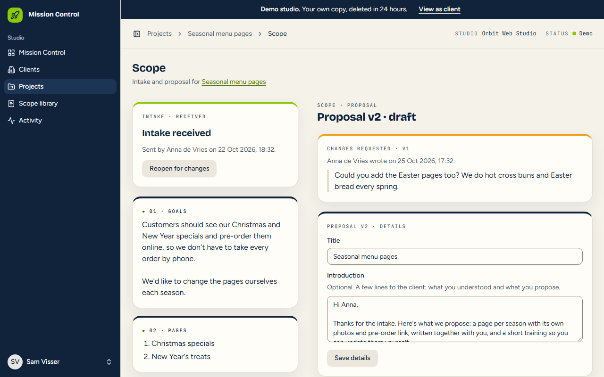
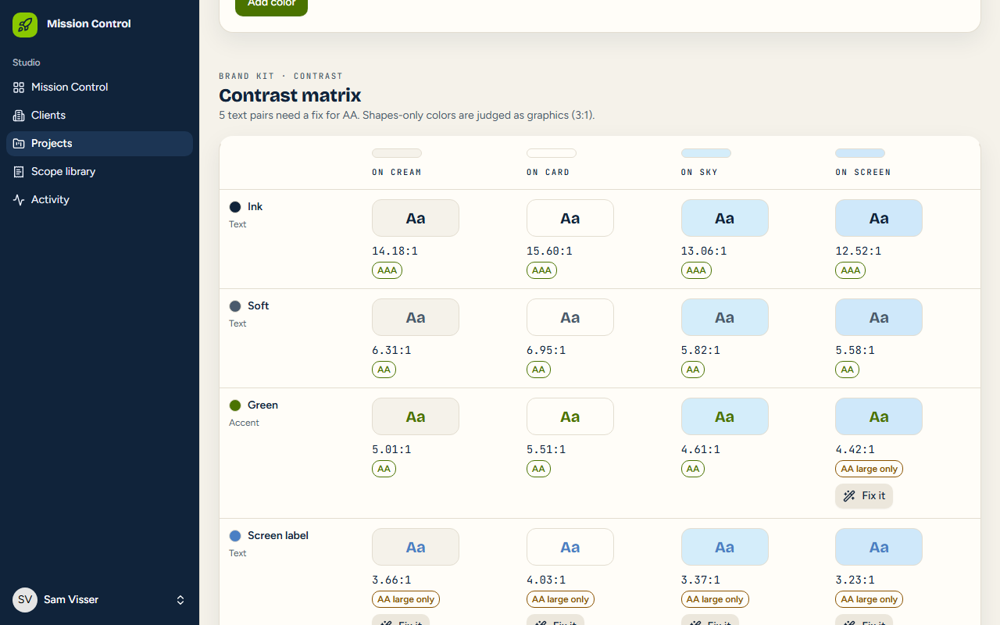
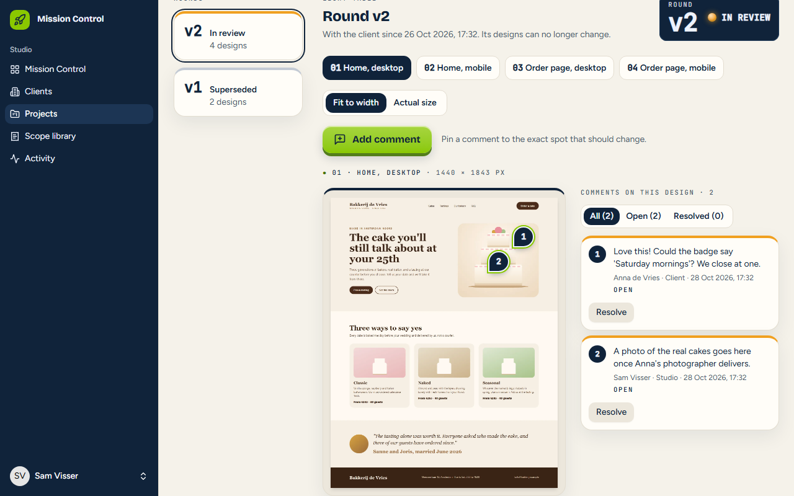
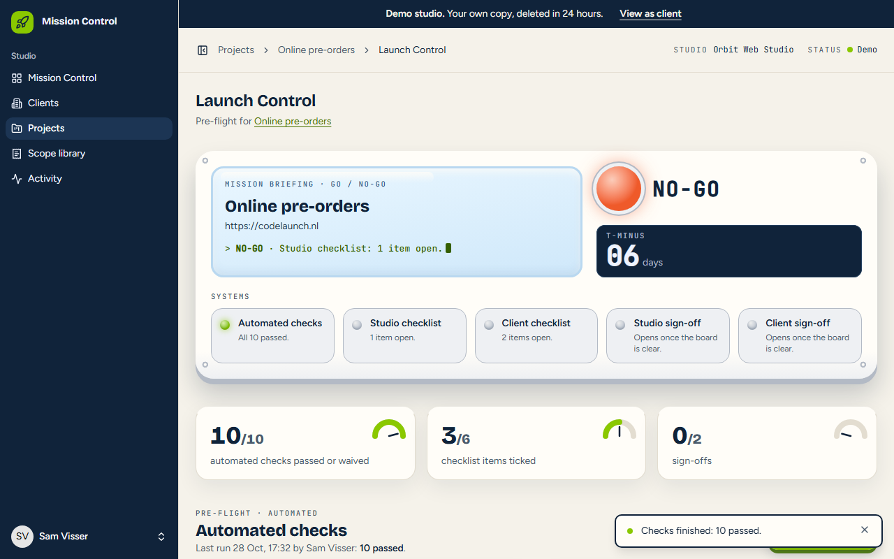

# Mission Control

**The tool I wish I'd had during 14 years of running a web design
business.** One Laravel app that runs a small web studio from first
conversation to launch day: a priced proposal, a brand kit, design
review, and a go/no-go launch. The studio works in **Mission Control**;
clients see what's waiting on them in **Launchpad**.

**[▶ Watch it fly](https://codelaunch.nl/mission-control/autopilot)**: the
autopilot logs in and runs the real app for you, with captions (about 2
minutes, or pick one module).
**[Take the controls](https://codelaunch.nl/mission-control/login)**: your
own demo studio, no sign-up, deleted after 24 hours.


## Four modules, one project

|                                                                                                                                                                                               |                                                                                                                                                                          |
| --------------------------------------------------------------------------------------------------------------------------------------------------------------------------------------------- | ------------------------------------------------------------------------------------------------------------------------------------------------------------------------ |
|                                                                                                |                                                              |
| **Scope.** Intake questionnaire, a price list, proposals in integer cents with VAT once on the total. Sending freezes a version; the client accepts by typing their name or asks for changes. | **Palette Lab.** Brand colors in OKLCH, a WCAG contrast matrix, "Fix it" for failing pairs, a type scale, design tokens to export and a style guide the client approves. |
|                                                                                          |                                                                   |
| **Proofmark.** Design rounds; the client pins comments on the exact spot, by mouse or keyboard crosshair, then approves the round.                                                            | **Launch Control.** Ten automated checks against the live site, a checklist for both sides, and a go/no-go board that needs every system green and both sign-offs.       |

## The 5 files I'd read first

1. [`app/Support/Http/SafeFetcher.php`](app/Support/Http/SafeFetcher.php):
   fetching a URL a user typed in, safely. Every hop is resolved, refused
   if any address isn't public, and then connected to exactly that address,
   so DNS can't be swapped in between (SSRF, [ADR 0007](docs/decisions/0007-ssrf-protection.md)).
2. [`app/Support/Launch/GoNoGo.php`](app/Support/Launch/GoNoGo.php) and
   [`Checks/`](app/Support/Launch/Checks/): a plugin-style registry of
   launch checks, and the board's verdict as one pure function, unit
   tested for every combination. Anything that makes a launch less ready
   voids the sign-offs.
3. [`app/Support/Color/Oklch.php`](app/Support/Color/Oklch.php) and
   [`ContrastFixer.php`](app/Support/Color/ContrastFixer.php): color
   science stored as integers. "Fix it" finds the nearest lightness that
   passes, keeping the hue, which is why it works in OKLCH and not RGB.
4. [`app/Support/Money/ProposalTotals.php`](app/Support/Money/ProposalTotals.php):
   money without floats. Integer cents, half-up rounding with `intdiv`, a
   discount, and VAT rounded once on the total ([ADR 0010](docs/decisions/0010-proposal-money-and-vat.md)).
5. [`resources/js/lib/tour/runner.ts`](resources/js/lib/tour/runner.ts):
   the autopilot. A pure TypeScript state machine (tested in Vitest
   without a DOM) that drives the real React pages through `data-tour`
   hooks, pauses when you take over, and respects reduced motion
   ([ADR 0011](docs/decisions/0011-autopilot-tour-engine.md)).

## How it was built

- **Stories first.** Every feature started as a user story with
  acceptance criteria ([`docs/stories/`](docs/stories/), 00–40), built
  one at a time with tests, reviewed for correctness, security and
  accessibility, and recorded in the commit message.
- **Decisions on record.** Twelve ADRs ([`docs/decisions/`](docs/decisions/)):
  hosting in a subfolder on shared hosting with no SSH, a demo sandbox per
  visitor, delivering a strict CSP, SSRF rules, uploads, money and VAT,
  the tour engine.
- **CI on every push.** Secret scan; Pint, Larastan (level 7), Oxlint and
  TypeScript; 760+ Pest tests on MariaDB and 70 Vitest tests; every
  autopilot tour run end to end in headless Chromium, plus axe on every
  page; then deploy, and a browser smoke test that clicks through
  production.
- **Accessibility.** WCAG 2.2 AA: keyboard, screen reader labels, 320 px
  and 200% zoom. How it's checked and what was fixed:
  [`docs/accessibility.md`](docs/accessibility.md).
- **Speed.** 100 for accessibility, best practices and SEO on every page
  measured; details in [`docs/lighthouse.md`](docs/lighthouse.md).

**Stack:** Laravel 13, PHP 8.5, Inertia 3, React 19 + TypeScript,
Tailwind 4, Pest, MariaDB. It runs on ordinary shared hosting: no queue
worker, no SSH, a strict Content-Security-Policy with per-request nonces.

## Run it locally

Requires PHP 8.5 (with `intl`, `gd`, `bcmath`, `pdo_mysql`, and `sockets`
for the test runner), Composer, Node 24 and MariaDB (or SQLite).

```
composer install
npm install
cp .env.example .env        # then fill in the database settings
php artisan key:generate
php artisan migrate
composer dev
```

Then open the login page and click **Take the controls** for a demo
studio. Tests: `php artisan test`; the autopilot in a real browser:
`npm run build && composer test:browser`.

The README's screenshots and GIF come from
[`scripts/record-media.mjs`](scripts/record-media.mjs) and
[`scripts/make-gif.py`](scripts/make-gif.py).
